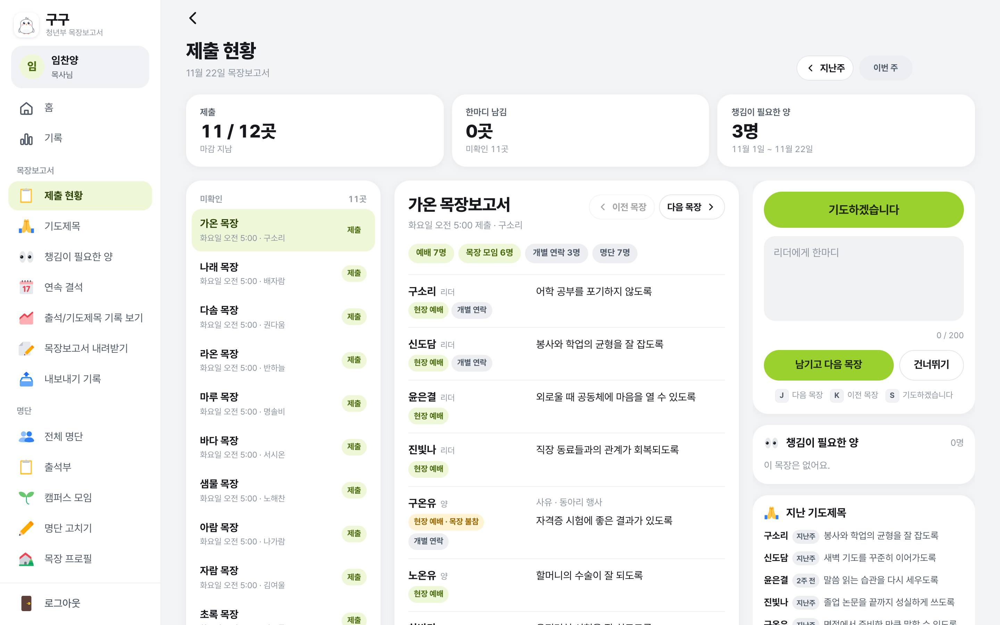
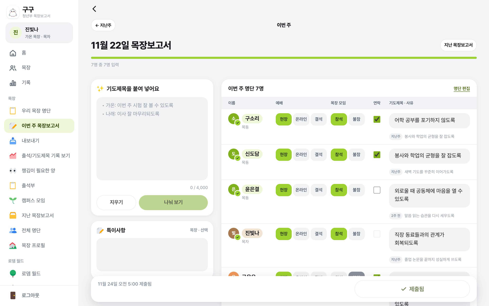
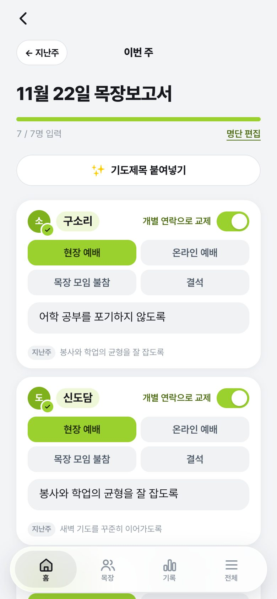
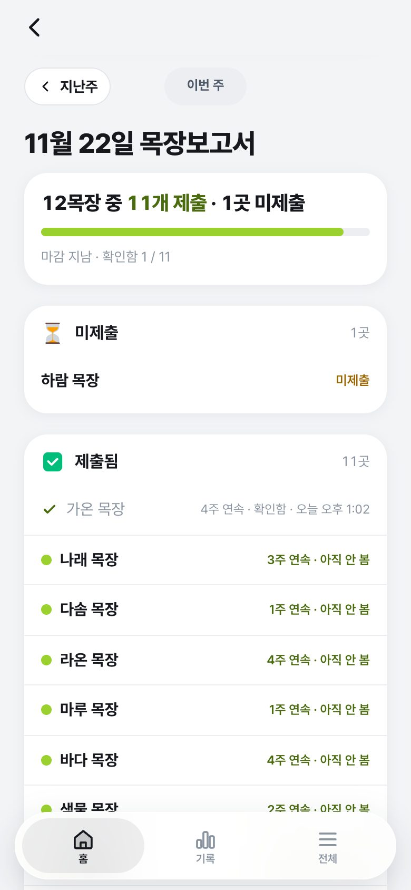
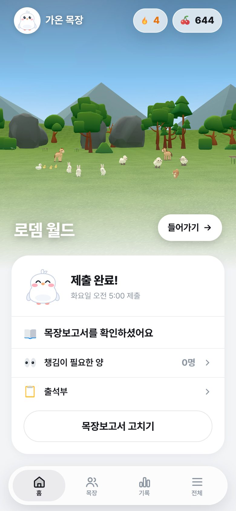
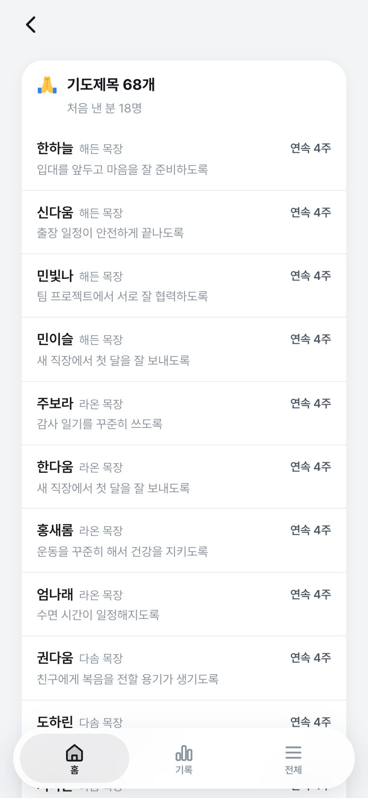
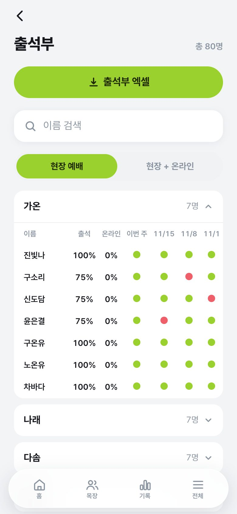
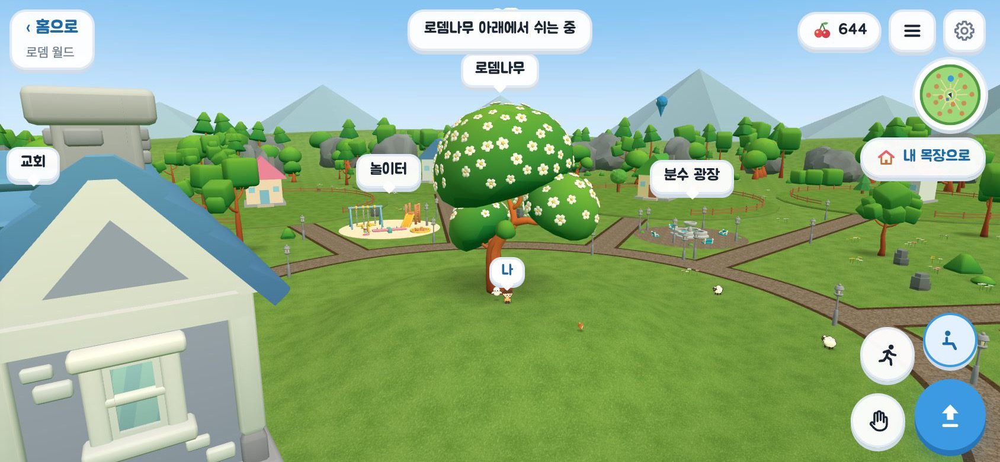
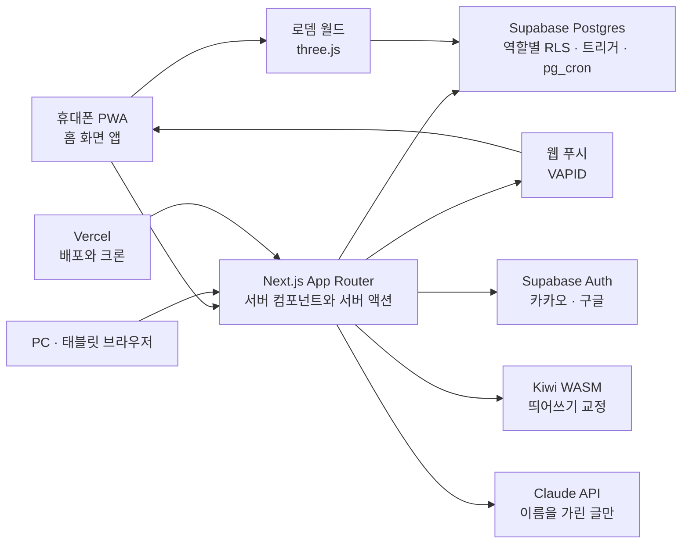

# 구구

Gugu is a progressive web app for weekly small-group reports in a church young adults ministry.
Group leaders record attendance and prayer requests on their phones, and the pastor reviews every group in one place.
This repository is a public snapshot of a private codebase.

교회 청년부 목장보고서 PWA다. 목장 리더가 휴대폰으로 출석과 기도제목을 기록하고, 담당 목사님이 모든 목장의 보고서를 한 화면에서 본다.

## 만든 이유

청년부는 종이 목장보고서를 썼다. 종이 보고서는 몇 달을 넘기지 못하고 중단됐다.
종이 시절 제출률은 약 30%였다. 목사님 피드백은 없었고 출석은 기록되지 않았다.

기획 문서(PRD)는 원인을 네 가지로 나눴다.
종이를 받아 쓰고 들고 가서 내야 했다. 제출해도 돌아오는 반응이 없었다.
누가 냈는지 아무도 몰랐다. 지난 기도제목을 다시 볼 수 없어 매주 빈 종이에서 시작했다.

구구는 이 네 가지를 줄이려고 만들었다. 목표는 모임이 끝나고 3분 안에 휴대폰에서 보고서를 내는 것이다. 목사님이 도장과 한마디를 남기면 리더에게 알림이 간다. 출석이 쌓이면 2주 연속 결석이나 4주 목장 불참 같은 돌봄 사각지대가 드러난다.

## 운영 현황

| 항목 | 값 |
|---|---|
| 운영 시작일 | 2026년 11월 시범 운영 시작, 2026년 12월 5일 정식 출시 예정 |
| 사용 인원 | 리더 약 50명, 목회자 1명, 관리 명단 약 110명 |
| 목장 수 | 12곳 |

## 화면

모든 화면은 로컬 Supabase와 가명 시드 데이터로 찍었다. 기도제목과 사유는 캡처용으로 지어낸 일반적인 내용이다.

PC 화면이다. 왼쪽은 목사님 제출 현황 작업대에서 목장 하나를 고른 모습이고, 오른쪽은 리더의 이번 주 목장보고서다.

| 목사님 제출 현황 작업대 | 리더 이번 주 목장보고서 |
|---|---|
|  |  |

휴대폰 화면이다.

| 리더 목장보고서 쓰기 | 목사님 제출 현황 | 홈 |
|---|---|---|
|  |  |  |

| 기도제목 | 출석부 |
|---|---|
|  |  |

로뎀 월드는 목장마다 집과 마당을 꾸미는 3D 마을이다. 세로로 든 휴대폰에서는 판을 돌려 가로로 그린다. 아래 그림은 가로로 돌려 놓은 것이다.



## 역할별 기능

| 역할 | 하는 일 |
|---|---|
| 리더 | 이번 주 목장보고서를 쓴다. 사람마다 출석과 기도제목, 개별 연락 여부를 고르고 특이사항을 남긴다. 붙여 넣은 모임 메모를 사람별 기도제목으로 나눠 채울 수 있다. 우리 목장 명단을 고치고 새가족을 더한다. 챙김이 필요한 양과 지난 보고서를 본다. |
| 목사님 | 주마다 목장별 제출 현황을 본다. 보고서를 열면 읽음이 남고, 도장과 한마디를 남기면 그 목장 리더에게 알림이 간다. 기도제목 모음과 연속 결석, 돌봄 사각지대를 본다. AI 주간 정리는 켜 두었을 때만 쓴다. |
| 운영자 | 가입 신청을 승인하고 명단과 계정을 관리한다. 휴주를 정하고 알림 현황과 내보내기 기록을 본다. 운영자는 보고서 본문을 읽을 수 없다. |
| 임원진 | 전체 명단과 출석부를 보고 명단 엑셀을 받는다. |
| 청년 | 앱을 쓰지 않는다. 명단에 이름이 오르고 리더가 기록한다. 기록은 2년이 지나면 지운다. AI 기능에는 동의한 사람의 기록만 쓴다. |

리더는 로뎀 월드에서 연속 제출로 모은 열매를 써서 목장의 집과 마당, 캐릭터를 꾸민다.

## 구조



화면은 Next.js 서버 컴포넌트가 사용자 세션으로 데이터를 읽어 그린다. 권한은 화면이 아니라 데이터베이스가 정한다. 마감 알림과 주간 정리는 Vercel 크론이 부른다. 기록 보관 기한 정리와 휴주 선물 같은 주기 작업은 pg_cron이 돈다.

자세한 설계는 [기획](docs/01-PRD.md), [화면 구조](docs/02-ia-screens.md), [지표](docs/03-metrics.md), [스키마](docs/04-schema.md), [기술 스택](docs/06-tech-stack.md), [개발 로드맵](docs/08-dev-roadmap.md) 문서에 있다.

## 기술 결정

### 역할별 RLS

리더는 자기 목장만, 목사님은 모든 목장을 읽는다. 운영자는 명단과 계정을 다루고 보고서 본문은 읽지 못한다. 이 규칙은 Postgres RLS 정책과 `security definer` 함수에 있다. 화면의 권한 검사는 보여 줄 내용을 고르는 데 쓴다. 보고서 제출과 목장 이동, 도장 같은 쓰기는 함수 안에서 권한과 기한을 다시 본다.

### 기록 당시 목장 기준 공개 범위

기록마다 그 주에 속한 목장(`group_id_at_write`)을 남긴다. 사람을 다른 목장으로 옮겨도 그 전 기록은 그 전 목장에서만 보인다. 새 목장의 리더는 옮기기 전의 기도제목과 사유를 볼 수 없다. 화면은 이 규칙을 담은 뷰 `weekly_records_visible`만 읽는다.

### 붙여 넣은 기도제목 나누기와 맞춤법 처리

리더가 모임 메모를 붙여 넣으면 이름으로 시작하는 줄을 그 사람의 기도제목으로 나눈다(`src/lib/memo-split.ts`). 나눈 글은 서버에서 규칙과 Kiwi 형태소 분석기(WASM)로 맞춤법과 띄어쓰기를 고치고 끝을 기도제목 꼴로 맞춘다. 이름으로 나누기와 맞춤법 처리는 AI를 쓰지 않는다. 리더는 고른 칸만 채우고 확인한 뒤 제출한다.

### 삼성 인터넷 홈 화면 앱 상태바 대응

삼성 인터넷으로 설치한 홈 화면 앱은 상태바와 내비게이션 바 밑까지 그리면서 safe-area 값을 0으로 준다. 머리 스크립트가 이 환경을 알아보고 `data-sbar` 속성을 붙인다. CSS는 이 속성이 있으면 막대 높이를 대신 넣는다(`src/lib/samsung-bars.ts`). 아이폰 홈 화면 앱의 화면 높이 버그는 문서 높이를 시계 자리만큼 늘려 피한다.

### AI 동의와 이름 가림

AI 기능에는 AI 사용에 동의한 사람의 기록만 넣는다. 동의 여부는 `persons.ai_consented_at` 하나가 기준이고, 제외 표시는 트리거가 맞춘다. Claude API에 보내기 전에 사람 이름을 `P01` 같은 기호로 바꾸고, 돌아온 글의 기호는 화면에서 이름으로 되돌린다(`src/lib/ai/anon.ts`). 저장하는 주간 정리에도 이름 대신 자리표시만 둔다.

### 넓은 화면 레이아웃

화면 폭은 CSS 미디어 쿼리로만 판단한다. 768px 이상에서는 하단 탭바 대신 왼쪽 아이콘 레일(72px)이, 1024px 이상에서는 펼친 사이드바(232px)가 나온다. 왼쪽 메뉴는 휴대폰 '전체' 화면과 같은 메뉴 정의(`src/lib/all-menu.ts`)를 읽는다. 1024px 이상에서 목사님 제출 현황, 리더 목장보고서, 출석부, 운영자 명단은 같은 데이터를 넓은 배치로 다시 그린다. 제출 현황 작업대는 고른 목장을 주소(`?g=`)에 남기고 J, K, S 단축키를 받는다. 768px 아래 휴대폰 화면은 그대로다.

## 개인정보 보호 설계

저장소의 시드와 시험 데이터는 모두 가명이다. 실제 명단은 저장소 밖에 두고 커밋하지 않는다.
AI 기능은 기본으로 꺼져 있다. 켜면 동의한 사람의 기록만 이름을 가려서 보낸다.
첫 접속 때 개인정보 처리방침 동의를 받고, 문구가 바뀌면 다시 묻는다. 기록은 2년이 지나면 지운다.
데이터베이스 백업은 암호화해서 보관한다.

## 품질

| 시험 | 수 |
|---|---|
| 화면과 로직 시험(Vitest, jsdom) | 540개 통과, 73개 파일. Kiwi 모델이 없으면 4개를 건너뛴다 |
| DB 권한 시험(Node test runner, PGlite에 마이그레이션 전체 적용) | 647개 통과, 58개 파일 |

`git push` 전에 린트와 두 가지 시험, 프로덕션 빌드를 모두 돌린다(`.githooks/pre-push`).

## 맡은 역할

기능 기획과 설계, 검토는 직접 했다. 코드는 Claude Code로 구현했다.

## 로컬에서 실행하기

Node.js와 Docker가 필요하다.

```bash
npm ci
npx supabase start
cp .env.example .env.local
npm run dev
```

`npx supabase start`는 마이그레이션을 적용하고 가명 시드(`supabase/seed_accounts.sql`, `supabase/seed.sql`)를 넣는다. 다시 넣으려면 `npx supabase db reset`을 쓴다.
`.env.local`의 Supabase 주소와 publishable 키에는 `npx supabase status`에 나온 로컬 값을 넣는다.
로그인은 카카오와 구글 OAuth로 한다. 로컬에서 로그인하려면 `supabase/config.toml`에 OAuth 제공자를 켠다.

시험은 Docker 없이 돈다.

```bash
npm run test:ui
npm run test:rls
```

`npm run build`는 빌드 전에 Kiwi 형태소 분석기 모델(약 104MB)을 받는다.

## 라이선스와 출처

Copyright © 2026 John Lee. All rights reserved. 이 저장소의 코드와 문서는 저작자가 모든 권리를 보유한다. 오픈소스 라이선스를 붙이지 않았다.

외부 자산은 각 라이선스를 따른다. 목록과 라이선스 전문은 [THIRD_PARTY_NOTICES.md](THIRD_PARTY_NOTICES.md)에 있다.
이 저장소의 앱 화면에는 토스팀에서 제공한 토스페이스가 적용되어 있습니다.
